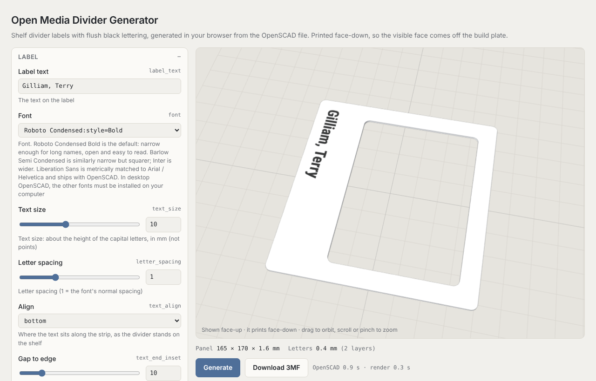

# Open Media Divider

Customizable shelf dividers for Blu-rays, DVDs, games and books, with **flush, two-colour lettering**, generated in your browser from an OpenSCAD file. Type a name, press Generate, download a 3MF, print.

**Live page:** https://thegabecodes.github.io/open-media-divider/

- Runs entirely in your browser. Nothing is uploaded; there is no server.
- The same `media_divider.scad` also works in desktop OpenSCAD's Customizer.
- **Defaults are sized for Blu-ray / 4K cases** (165 × 170 mm panel). For books, DVDs or games, change the width and height to suit your shelf.
- Not affiliated with OpenSCAD or Bambu Lab.

---

## What it makes

A thin panel that stands between sections of a media shelf. A solid **text strip** along the front edge carries a label such as `Gilliam, Terry`, `Kubrick, Stanley` or `Kurosawa, Akira`, reading bottom-to-top like a book spine.

The letters are **set flush into the face**: the panel prints **face-down**, so the visible face comes off the build plate smooth and the lettering sits level with it, not raised.

Each divider is two parts, **Body** and **Letters**. By default you download them as one **3MF** that opens as a single object with both parts; you can also download them as two STLs:

| Part (STL file) | What it is | Usual colour |
|---|---|---|
| Body (`…_Body_White.stl`) | Panel, with the letters cut out of the face | White |
| Letters (`…_Letters_Black.stl`) | Letters, plus the optional backing behind the face (see [Backing](#backing)) | Black |

The colours are only names. You assign real filaments in the slicer, so white letters on a black body works too: swap the two.

### Shapes (`type`)

| Type | Shape | Notes |
|---|---|---|
| `full` (default) | Frame with a window | Least material (the window removes about half the panel). One per plate on a 256 mm bed; two side by side need about 333 × 170 mm, so they fit beds around 335 mm or wider. |
| `L` | Text strip + bar along the shelf edge | About the same material as `full`. **Two fit on one plate.** No back edge. |
| `U` | `L` + a back leg, open at the top | For shelves without a flat back (open backs, or rails at different heights): the back leg reaches the back of the shelf at any height, so every divider sits at the same depth. About 38% more material than `full`. **Two fit on one plate.** |

**Two per plate (L and U):** import the parts twice, rotate the second copy 180°, and slide the legs together. At the default size with a 3 mm gap, a pair takes about **213.5 × 218.5 mm**, which fits a 256 mm bed. This is manual for now.

---

## Using the generator

1. Open the page and type the label text.
2. Adjust any settings. They are the same as the OpenSCAD Customizer, grouped the same way.
3. Press **Generate**. The 3D preview shows the face as it will look on the shelf. Warnings appear if the text is cut off or runs into the window.
4. Choose the download format under the buttons and press **Download**:
   - **3MF (default):** one file, one object with two parts. Set **Body filament** and **Letters filament** to the filament slots you use (default 1 and 2); Bambu Studio and OrcaSlicer pre-assign them.
   - **STLs (.zip):** the body and letters as separate STL files.

   The page remembers your format and slot choices in your browser.

The first Generate can take a few seconds while the OpenSCAD engine (about 14 MB) loads from the CDN. After that, a typical label takes under a second.

### Slicing

**With the 3MF (default):** open or import it. You get one object with two parts, Body and Letters, already lined up, face-down and mirrored so the text reads correctly from the front.
- **Bambu Studio / OrcaSlicer:** the parts come in assigned to the filament slots you chose in the generator. These slicers may note that the file wasn't made by them; that's fine.
- **Other slicers:** the geometry loads; assign a filament (or extruder) to each part yourself.
- Either way, check the two parts are on the filaments you expect after loading.

**With the STLs:**
1. **Import both STLs at the same time.** Most slicers ask whether to treat multiple files as one object; say yes. You want **one object with two parts**, so the letters stay registered in the body.
2. **Assign a filament (or extruder) to each part:** letters black, body white (or swapped). In the object list, expand the object to see its two parts.
3. **Don't move, rotate or scale the parts individually.** Move the whole object if you need to.

Either way, print solid: the panel is only a few layers thick, so the slicer will normally fill it completely anyway.

Where the "one object" prompt appears when importing the STLs (worded slightly differently between versions):

| Slicer | How |
|---|---|
| **Bambu Studio / OrcaSlicer** | Import both files together and answer **Yes** to loading them as a single object with multiple parts. Then pick a filament for each part in the object list. |
| **PrusaSlicer** | Import both files together and answer **Yes** to treating them as a single object with multiple parts. Then set the extruder for each part in the object list. |
| **Others** | Look for "multi-part object", "merge" or "load as one object" when importing, then assign extruders per part. |

**Tips from testing (Bambu Studio, PETG), all optional:**
- **Fewer filament changes:** the automatic first-layer order can print the letters first and add an extra change. To set it yourself, click the plate (*Plate 1* or its settings icon in the object list) → *First layer filament sequence* → *Customize*, and drag the body colour first.
- **Arachne** wall generator helps thin letter strokes fill properly.
- **Stray dark specks in white** usually mean not enough purge after a dark-to-light change. Raise the flushing volume (for example the multiplier to about 1.3–1.5) and make sure the filament is dry.

---

## Settings

| Setting | Default | What it does |
|---|---|---|
| **Label** | | |
| `label_text` | `Gilliam, Terry` | The text |
| `font` | Roboto Condensed Bold | Also Barlow Semi Condensed Bold (similar width, squarer), Inter Bold / SemiBold (wider), Liberation Sans Bold / Regular (Arial/Helvetica metrics). All embedded in the page |
| `text_size` | 10 | **Capital-letter height in mm**, not points |
| `letter_spacing` | 1.0 | 1 = the font's normal spacing |
| `text_align` | bottom | Where the text sits along the strip, as the divider stands on the shelf (`bottom`, `center`, `top`) |
| `text_end_inset` | 10 | Gap from the bottom (or top) end of the strip to the text |
| `baseline_inset` | 10 | Distance from the strip's front edge to the text baseline |
| **Panel** | | |
| `panel_width` × `panel_height` | 165 × 170 | Overall size (front to back × height), mm |
| `thickness` | 1.6 | Total thickness, mm |
| `corner_radius` | 5 | Outer corners; also the inside corners of L and U |
| `strip_width` | 45.5 | Width of the text strip, and of the L/U bars |
| **Type** | | |
| `type` | full | `full`, `L` or `U` (see above) |
| **Window** (full only) | | |
| `window` | on | Cut the window |
| `window_margin` | 15.5 | Frame width on the other three sides |
| `window_radius` | 5 | Window corner radius |
| **Print** | | |
| `layer_height` | 0.2 | The layer height you print at. Letter, face and backing depths are counted in layers, so **set this to match your slicer** |
| `letter_layers` | 2 | How many layers deep the letters go (depth = layers × layer height) |
| `backing` | None | `None` or `Letter colour` (see below) |
| `face_layers` | 5 | Layers of body colour in front of the backing; the backing fills the rest of the thickness |

### Backing

White filament is fairly see-through. Light passing through the panel is blocked where the black letters are, so the letters show faintly **from the back** as grey shapes, more so in bright light. Making the white thicker barely helps: the white would have to be several millimetres thick.

`backing = Letter colour` adds a layer in the letter colour behind the face, which blocks that light completely. At 1.6 mm the panel is then:

| | Depth | Colour |
|---|---|---|
| Face (letters set into it) | 1.0 mm (5 layers) | Body |
| Backing | 0.6 mm (3 layers) | Letters |

The generator shows these numbers under the preview.

**Why it's off by default:** in testing, the white face in front of a black backing looked slightly greyer than an all-white panel, and an all-white divider looks cleaner overall. Turn it on if the faint show-through bothers you more. Other trade-offs:
- **One more filament change.**
- **A thin dark line along every edge** (the backing showing at the sides).
- More `face_layers` keeps the face whiter, at the cost of a thinner backing. Community-measured "transmission distance" values put white PETG around 3–6 mm, against about 0.3 mm for black; a transmission-distance test card in your own filaments is the quickest way to choose.
- **Meant for dark letters on a light body.** With light letters on a dark body, the dark body already hides everything.

---

## Design notes

- **Face-down, flush letters.** The face is the smoothest surface you can get (the plate), and flush letters can't catch or chip. The letters only need to be a couple of layers deep to read as solid colour from the front.
- **Backing.** An earlier version used a solid black lower half with only a thin white skin, which read grey. An all-white panel looks brightest but lets the letters show through faintly from the back; that's the default. The optional backing (1 mm white face, thin black behind) is the middle ground.
- **Text size is in mm.** OpenSCAD's `text(size = …)` is roughly the capital height in millimetres, not a font point size. Size 10 is easily readable at arm's length. At size 10 in the default Roboto Condensed Bold, about 150 mm of strip fits around 24 characters, depending on the letters; `Anderson, Paul Thomas` takes about 131 mm. Wider fonts such as Inter fit about 20% less, so long names may need shortening (`Anderson, P.T.`).
- **Window.** Removes about half of the panel's material and first-layer area, and the open frame looks less bulky on the shelf.
- **L and U** exist so two dividers fit on one plate, which halves the plate swaps and filament changes per divider. `U` also gives a full-height back edge, which matters on shelves whose back is open or has rails at different heights.
- **Stiffness.** 1.6 mm PETG flexes noticeably through its thickness. It's stiff in-plane, so it holds its shape on the shelf; raise `thickness` if you want it firmer (2.0 mm is a reasonable step).

---

## Using the .scad directly (desktop OpenSCAD)

1. Open `media_divider.scad` in OpenSCAD and use the **Customizer** panel.
2. Fonts: Liberation Sans ships with OpenSCAD. **Inter, Barlow Semi Condensed and Roboto Condensed must be installed on your computer** (all free from Google Fonts; Inter also from https://rsms.me/inter/); otherwise OpenSCAD quietly substitutes another font.
3. Export each part: set `part` to `white`, render (F6) and export STL; then the same for `black`. (`both` is for preview only.)
4. Text layout can differ slightly between OpenSCAD versions. In testing, an older desktop release (2021.01) produced slightly shorter text than the browser build. If a long label is close to the limit, check it in the version you export from.

---

## How the page works

`index.html` is a single static page:

- **OpenSCAD in the browser:** [openscad-wasm](https://www.npmjs.com/package/openscad-wasm) 0.0.4, loaded from jsDelivr, runs in a Web Worker using the Manifold backend. Two runs per Generate (body, then letters plus any backing).
- **The page loads `media_divider.scad` and the fonts in `fonts/` from this repository** (relative paths), so the `.scad` here is the single source of truth: edit it, commit, and the live page uses the new version. The fonts don't depend on the visitor's computer.
- **The settings form is built from the Customizer comments** in the `.scad` (`/* [Group] */`, `// help text`, `// [min:step:max]`, `// [a, b, c]`).
- **3MF export** is built in the page: the two meshes become parts (components) of one object, and the filament slots go in `Metadata/model_settings.config`, which Bambu Studio and OrcaSlicer read.
- **Preview:** three.js r128 (cdnjs / jsDelivr). **Zip / 3MF packaging:** JSZip 3.10.1 (cdnjs). **UI fonts:** IBM Plex from Google Fonts.

Because the libraries come from public CDNs, the page needs an internet connection the first time it's opened (browsers then usually cache them).

**Running a local copy:** browsers won't let a page opened straight from disk (`file://`) load the files next to it, so serve the folder instead: run `python3 -m http.server` in it and open http://localhost:8000.

---

## Licence and credits

- **This project** (the generator page and `media_divider.scad`): **GNU General Public License v3.0 or later**. See [`LICENSE`](LICENSE). You're free to use, modify and share it; if you share a modified version, it has to stay under the GPL with its source available.
- **Fonts**, embedded in `index.html`: Inter (the Inter Project Authors), Barlow Semi Condensed (the Barlow Project Authors), Roboto Condensed (the Roboto Project Authors) and Liberation Sans (Red Hat / Google), all under the SIL Open Font License 1.1. Font files are in `fonts/`; licence texts are in `LICENSES/`.
- **Loaded from public CDNs, not stored in this repository:** OpenSCAD via openscad-wasm (GPL-2.0 or later), three.js (MIT), JSZip (MIT or GPLv3), and the IBM Plex interface fonts (OFL, Google Fonts).
